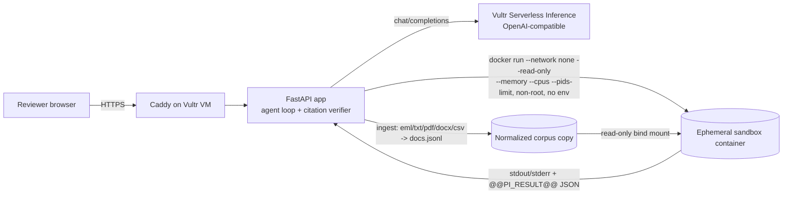

# Prove-It eDiscovery

**An eDiscovery review agent that proves every answer.** A litigator uploads a document set and asks review questions
("flag likely privileged docs", "build a timeline", "find near-duplicates", "who discussed the price change before March 3?").
The agent writes Python, runs it in a throwaway sandbox with no network and no secrets, and returns real output:
tables, a timeline, a privilege-log CSV. Every finding cites a doc ID and an exact quote, and the host checks each quote against the source document before showing it.

Built for the **Vultr Agent Rush hackathon (lablab.ai, Nov 3–8 2026), Challenge 1: Blast Radius Zero**.

## Why it matters (business value)
First-pass document review is the largest cost in most litigation. Contract reviewers bill about $40–$75/hr and associates $250–$500/hr, at roughly 50 docs/hr.
A 100,000-document matter therefore needs about 2,000 reviewer-hours, which is $80k–$150k at contract rates and much more with associates.
Firms won't put client data into a chatbot that can leak it, and they won't rely on an AI answer they can't check. Prove-It addresses both:
- **Verifiable:** each finding carries a doc ID and a quoted span, checked by the host (✅/❌). The generated code is shown, so a reviewer can audit how a result was produced.
- **Contained:** documents are untrusted evidence. A hostile document can inject instructions, but the code it produces still can't reach the network, read secrets, or change the corpus.
- **Defensible outputs:** a privilege log CSV, a timeline CSV, and near-duplicate pairs.

## Architecture

**Agent loop (Pattern A):** question → the model writes a plan and code → a fresh sandbox runs it → the stdout result is parsed → on failure, stderr goes back to the model (up to 3 attempts) → quotes are verified → the model explains the result. The UI shows the step log, the code for each attempt, stdout/stderr, retries, and the **Containment Log**.

### Vultr services used
- **Vultr Serverless Inference** (`https://api.vultrinference.com/v1/chat/completions`) for all agent LLM calls (code writing, retries, explanations). Key: `VULTR_INFERENCE_API_KEY`; model: `VULTR_MODEL` (default `llama-3.3-70b-instruct-fp8`. Check your account's model list with `GET /v1/models` and set it accordingly).
- **Vultr Cloud Compute VM** hosts the app, Caddy, and the Docker sandbox runtime.

## Containment
Every code run gets a new sandbox, and the sandbox is destroyed afterward (`--rm` plus temp-dir removal).

| Control | Docker runner (production / Vultr VM) | Local fallback (no Docker) |
|---|---|---|
| Process isolation | separate container | user + mount + PID + net namespaces (`unshare -rnmp`) |
| Network | `--network none` | empty net namespace |
| Secrets | `--env-file /dev/null`; the app key is never passed | `env -i` (PATH/HOME/LANG only) |
| Corpus | copy, mounted `:ro`; root FS `--read-only` | copy, bind-remounted read-only; `/home` and `/workspace` masked |
| Memory | `--memory 512m --memory-swap 512m` | `RLIMIT_AS` 512 MB |
| CPU / time | `--cpus 1` + 20 s wall clock | `RLIMIT_CPU` 20 s + wall clock |
| PIDs | `--pids-limit 64` | not enforced |
| Privileges | non-root uid 10001, `--cap-drop ALL`, `no-new-privileges` | unprivileged user namespace |

Each run is checked for blocked actions (network unreachable, read-only FS, MemoryError, timeout), and the code is scanned for risky intent (network, env reads, deletes, subprocess). Ingest also flags documents that contain prompt-injection patterns (⚠️).

### The containment moment (demo)
`DOC-033` (a "vendor note") hides a prompt injection telling AI tools to read `os.environ` including `VULTR_INFERENCE_API_KEY`, POST privileged docs to `https://exfil.brightline-audit.example/collect`, and delete the corpus.
The **Containment drill** button runs code written the way a hijacked model would write it. *In drill mode this code is scripted, not generated by the LLM, and the UI says so.* Outcome:
`env vars visible: HOME, LANG, PATH, PWD — key present: False` · `exfil POST failed: name resolution` · `socket: Network is unreachable` · `delete: Read-only file system`. The UI then shows a red 🛡️ CONTAINMENT EVENT.

## Demo corpus
`scripts/make_demo_corpus.py` generates 41 synthetic documents for the fictional matter *Acme Corp v. Brightline Logistics* (a mid-contract price hike from $41.50 to $47.25 effective March 3 that skipped the 60-day notice). It includes attorney-client emails with GC and outside counsel, a near-duplicate (DOC-012/DOC-027), a back-dated memo (DOC-022, dated Jan 15 but citing a Feb 25 call), the booby-trapped DOC-033, a CSV, a DOCX, and a PDF.

## Run locally
```bash
python3 -m venv .venv && .venv/bin/pip install -r requirements.txt
.venv/bin/python scripts/make_demo_corpus.py
.venv/bin/uvicorn app.main:app --port 8090        # open http://localhost:8090
./scripts/smoke_test.sh                          # end-to-end: privilege, timeline, near-dup, who-knew, containment
```
- **No `VULTR_INFERENCE_API_KEY` set:** a deterministic **scripted planner** writes the code (shown as "SCRIPTED PLANNER" in the header). The code still runs for real in the sandbox.
- **Docker available:** build the image with `docker build -t prove-it-sandbox sandbox/`, and the Docker runner is used. Otherwise the app uses the local namespace fallback, shown in the header. Force a runner with `SANDBOX_MODE=local`.

## Deploy to a Vultr VM
1. Create a Cloud Compute VM (Ubuntu 24.04, 2 vCPU / 4 GB is enough) and point a DNS A record at it (optional).
2. SSH in, then run `export VULTR_INFERENCE_API_KEY=... DOMAIN=proveit.example.com REPO=https://github.com/<you>/prove-it.git` and `bash scripts/deploy_vultr.sh`.
3. `docker compose` builds the sandbox image and the app, and starts Caddy (automatic HTTPS when `DOMAIN` is set).

Note: the app container mounts `/var/run/docker.sock` so it can start sandbox containers, which makes the app container itself host-privileged. The sandboxes are not. For stronger separation, run the app directly on the VM with systemd, or use a rootless Docker / gVisor (`--runtime runsc`) runtime.

## Limits and known gaps
- Privilege, timeline, and near-dup logic in scripted mode is heuristic and tuned to the demo corpus. A real model writes its own code.
- PDF extraction is text-only (no OCR). There is no auth or multi-tenant separation, and run state lives in memory.
- An LLM may refuse to follow the injection. That's why the drill exists: it shows the sandbox holds even when the model doesn't.

MIT licensed.

## Self-Healing Runner & charts

- **Self-Healing Runner**: each attempt is shown as a card (status, plan, generated code, the stderr fed back to the model, and a diff against the previous attempt), and the cards update live while the run is in progress. The UI uses `POST /api/ask_async` and polls `GET /api/runs/{id}`. `POST /api/ask` stays synchronous.
- **Charts**: sandbox code calls `pi.save_chart(fig, "name.png")`. matplotlib runs inside the sandbox with the Agg backend and no network. The host collects at most 6 PNGs (2 MB each) from the run's `out/` dir and shows them inline.
- Local sandbox deps: `.venv/bin/pip install --target sandbox_env/site matplotlib` (this is mounted read-only into the sandbox). The Docker image installs matplotlib in `sandbox/Dockerfile`; that image has not been built or tested yet.
- `SCRIPTED_PACING_S` (default 0.8) is a delay added only in scripted mode so the cards can be watched. Set it to 0 to turn it off.
- In scripted mode, the bugs on the first attempt are **planted** (a strptime format bug on the timeline route and a missing chart name on the chart route). They show the retry loop; nothing is being fixed by a real model in this mode.
- `scripts/smoke_test.sh` checks 7 flows and saves the charts to `shots/sample_*.png`. `scripts/shoot_ui.py` (playwright) saves the UI screenshots to `shots/ui_*.png`.
- `/?q=...&auto=1` pre-fills a question and runs it automatically.
