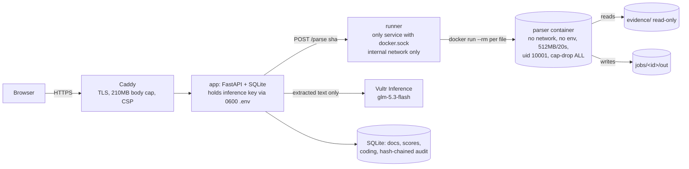

# Prove-It eDiscovery

An automated first-pass eDiscovery tool. It ingests a document collection, parses every file inside its own throwaway sandbox, dedupes and threads the documents, and scores them against a review protocol using **Vultr Serverless Inference (glm-5.3-flash)**. It then hands a ranked queue to a human reviewer. The model only gives advice. A human makes every coding call.

Built for the lablab.ai × Vultr **Agent Rush** hackathon, Challenge 1 "Blast Radius Zero".

**Live:** https://207-246-93-241.sslip.io (click *Ingest → Load Enron demo collection*)

## What it does

| Stage | What happens |
|---|---|
| Ingest | Upload files or a .zip, or load the Enron demo. Uploads are streamed with a 200 MB cap (413 above it), rate-limited to 6 per 10 minutes per IP, and capped at 500 files. Every item gets a control number (`ENR-000123`) and a SHA-256 hash. The evidence is copied once and stored read-only (0444). |
| Sandboxed parsing | PDF, DOCX, XLSX, CSV, EML, MSG, MBOX, HTML, TXT, ZIP, and images. **OCR** (tesseract, inside the same sandbox) runs on PNG/JPEG/TIFF and on PDFs with no text layer, capped at the first 20 pages and a 14 s budget; OCR'd documents carry an *OCR* badge. Each file, including every child of every zip or mbox, is parsed in a fresh `docker run --rm` container with `--network none`, a read-only evidence mount, a per-job `/out` only, 512 MB memory, 1 CPU, 64 pids, a 20 s timeout, uid 10001, `--cap-drop ALL`, `no-new-privileges`, a read-only rootfs and an **empty env**. The container is destroyed after every file. |
| Needs manual processing | Bombs, timeouts, OOMs, crashes and encrypted or unsupported files are flagged with the exact reason instead of silently dropped. |
| Analytics | Metadata extraction, exact-hash dedupe, email content-hash dedupe, threading (References/In-Reply-To, then normalized subject), near-dup groups (5-word shingles, Jaccard ≥ 0.8), and families (container → children). |
| Review protocol | A form for issues/requests, the date range, attorney names, law-firm domains and privilege terms. |
| Scoring | glm-5.3-flash sees **extracted text only** (truncated to 12k chars), wrapped as untrusted data. It returns relevance, a score per issue, privilege, hot, and a rationale. Every supporting quote is **verified** against the source text (exact match, or a match where only whitespace differs) and highlighted. Unverified quotes are labelled as such. A **deterministic privilege pre-screen** runs independently of the model and requires a *legal-advice signal*: outside counsel (protocol domains such as velaw.com or andrews-kurth.com) in the header, in-house counsel combined with advice language, an explicit privilege legend that is not a boilerplate footer (footers are stripped first), or litigation/work-product language. A lawyer's routine business email scores at most 20, and a non-lawyer third party on the email costs points (possible waiver). The pre-screen and the model's privilege score are blended (`0.6 × pre-screen + 0.4 × model`); a document goes on the draft privilege log only if this combined score is ≥ 50 or a reviewer coded it privileged. A 110 RPM pacer keeps under the 120 RPM limit. |
| Review queue | Ranked list with filters (issue, *on draft privilege log*, privilege source, hot, coded, custodian, text). The viewer shows metadata, model output, verified spans, thread, family and near-dups. Coding: Responsive / Not responsive / Privileged / Hot plus a note, then *Save & next*. |
| QC | Model-vs-human confusion matrix, plus a random **elusion sample** drawn from the low-score discard pile with a recall estimate once it has been coded. |
| Chain of custody | A hash-chained audit log (every entry includes the previous hash; tampering is detected). There is a one-click re-hash of all evidence against the ingest hashes. |
| Exports | Coding CSV, a **DRAFT** privilege log (metadata and basis only, never content), and an audit-log CSV. |

## Architecture



## Threat model

| Threat | Mitigation |
|---|---|
| Malicious or malformed file (zip bomb, decompression bomb, parser exploit, pathological PDF) | Parsed only in a per-file container with no network, no secrets, memory/CPU/pid/time caps, a non-root user, no capabilities and a read-only root. The parser also has its own caps (zip ratio and size, member count, depth 4, text cap). A failure becomes a *needs manual processing* flag. It cannot take down the batch. |
| Exfiltration of the API key from a compromised parser | The key is only in the app container (via root-owned 0600 `/opt/prove-it/.env`). Parser containers get an empty env and no network. The runner has no key. |
| Docker socket abuse | Only the runner mounts the socket. It sits on an internal-only network, accepts only a sha256 plus a type hint, and builds the `docker run` argv itself. |
| Prompt injection inside documents | The text is wrapped and labelled as untrusted data. The model output is advisory only. Quotes must be verified against the source. The model cannot take actions. Privilege has an independent deterministic pre-screen. |
| Evidence tampering | SHA-256 at ingest, read-only files, re-hash verification, and a hash-chained audit log. |
| Resource abuse via upload | 200 MB cap enforced while streaming plus at Caddy, a per-IP rate limit, and a file-count cap. |

## Live demo numbers (Enron demo, 2026-11-03)

- 598 items: 592 parsed, 2 containers, 12 exact dups, 580 reviewable, 534 threads, 6 near-dup groups, 4 flagged for manual processing.
- Three genuine, unmodified Enron emails with outside counsel are always included: `lay-k/discussion_threads/204` (Vinson & Elkins to Ken Lay, with a real V&E privilege legend), `shackleton-s/inbox/216` (Raptor unwind) and `shackleton-s/notes_inbox/477` (Andrews Kurth).
- Draft privilege log: **11 entries** (the old pre-screen-only log had 129). The top entry is the V&E email (combined score 95).
- `zz_added_test_files/SCANNED_enron_email_shackleton-s_notes_inbox_1449.pdf` is an **added test file**: a genuine Enron email (unmodified text) rendered as an image-only, 2-page PDF. Sandboxed OCR recovers its text (about 9 s), and it carries an OCR badge.
- Stress-test files (deliberately added to the demo, labelled `zz_stress_tests_added_to_demo/`):
  - `zip_bomb_4GiB.zip`: caught by the zip-bomb ratio cap.
  - `pdf_flate_bomb.pdf`: killed by the 512 MB memory limit (OOM).
  - `pdf_pathological_4000_pages.pdf`: killed by the 20 s timeout.
  - `docx_memory_bomb.docx`: killed by the 512 MB memory limit (OOM).
  - `huge_trade_blotter_100MB.csv`: parsed with the text capped.
- Scoring: 580 documents in about 5 minutes, 692k input / 80k output tokens, **about $0.10**. 0 errors. 10 responsive, 19 model-privileged, 2 hot.
- Evidence re-hash: 598/598 match. Audit chain OK.

## Run it

```bash
# server (Ubuntu + Docker)
sudo scripts/deploy_vultr.sh          # creates /var/lib/prove-it, writes .env (0600) only if missing
# demo set is built offline and copied over:
python scripts/build_demo.py /path/to/enron/maildir demo_out
scp demo_out/enron_demo.zip demo_out/protocol.json server:/var/lib/prove-it/demo/
docker compose build && docker compose up -d app runner caddy
python scripts/smoke.py https://your-host       # end-to-end check

# tests (no network, fake scorer, local namespace sandbox)
pip install -r requirements-dev.txt && PYTHONPATH=$PWD pytest -q
```

## Known limitations

- This is a first-pass triage aid, not a defensible TAR workflow. The recall estimate comes from a small elusion sample and has wide confidence bounds.
- The privilege log is a **draft** for attorney review. Signals are heuristic: unknown attorney aliases or firms not in the protocol will be missed by the pre-screen and rely on the model.
- OCR covers only the first 20 pages of a scan, English only, with no handwriting support. No .pst/.msg-attachment deep extraction beyond what the parser supports. Encrypted files are flagged, not cracked.
- No user accounts or auth. The Enron demo matter is **shared and locked**: its protocol cannot be edited and files cannot be added to it (HTTP 403), and *Load Enron demo* opens the existing matter instead of re-ingesting. Visitors can still code documents and draw QC samples there, which are temporary: a *Reset demo* button and an automatic nightly reset (04:00 ET) clear all coding and QC samples, and each reset is audited. New matters created by uploading keep working with the normal caps.
- Model text is truncated at 12k characters per document. Long documents are scored on their beginning.
- The SQLite and single-VM design is sized for thousands of documents, not millions.
- The demo's Enron emails are real public data. Their selection is keyword-biased (about 45% hits) so that the demo has something to find.
